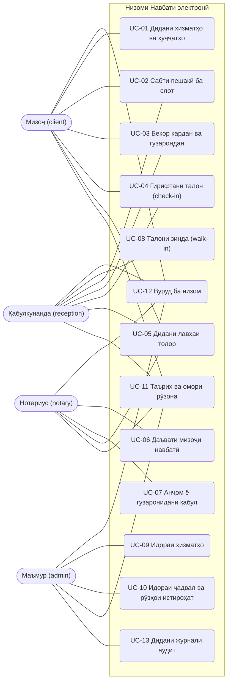
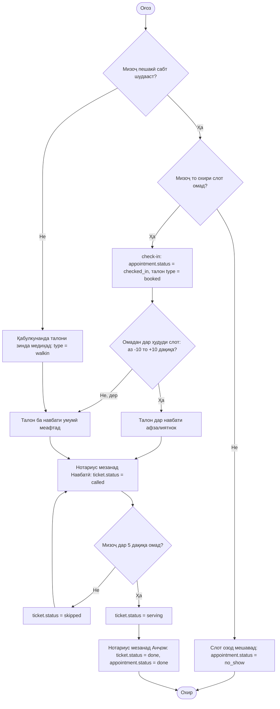
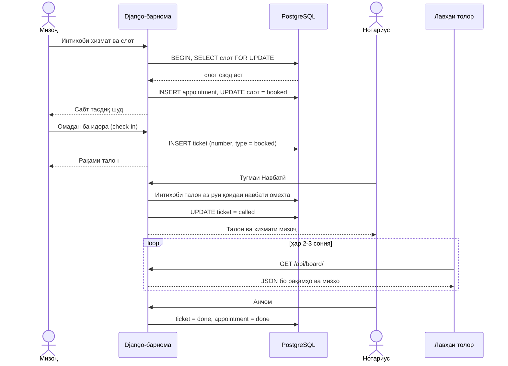
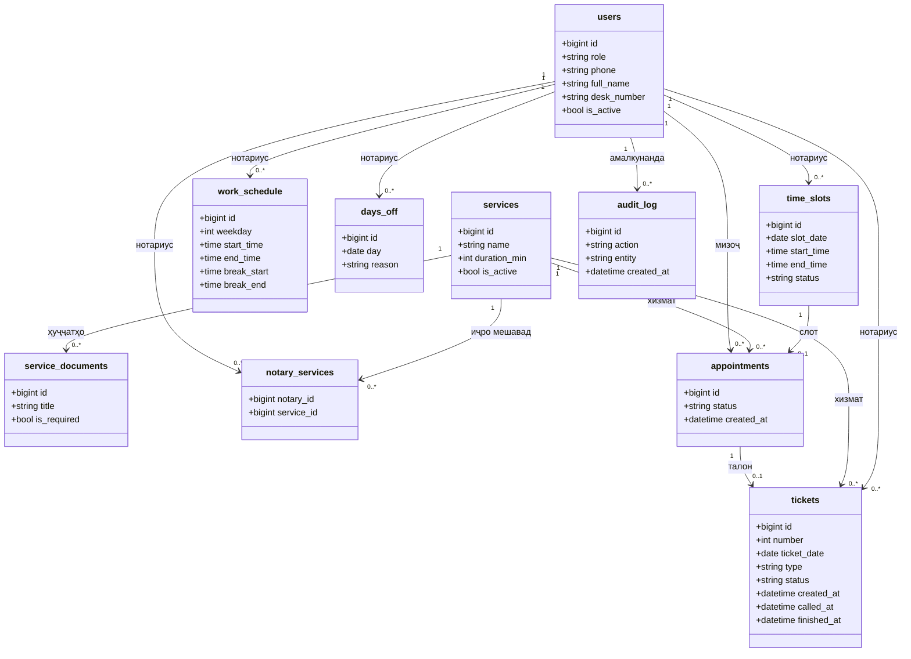
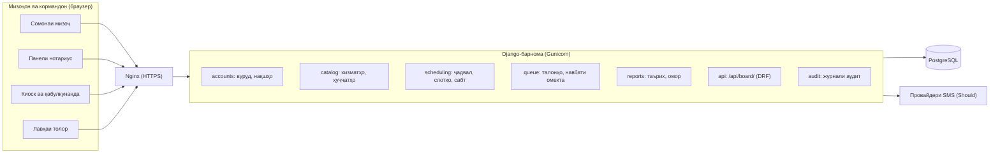
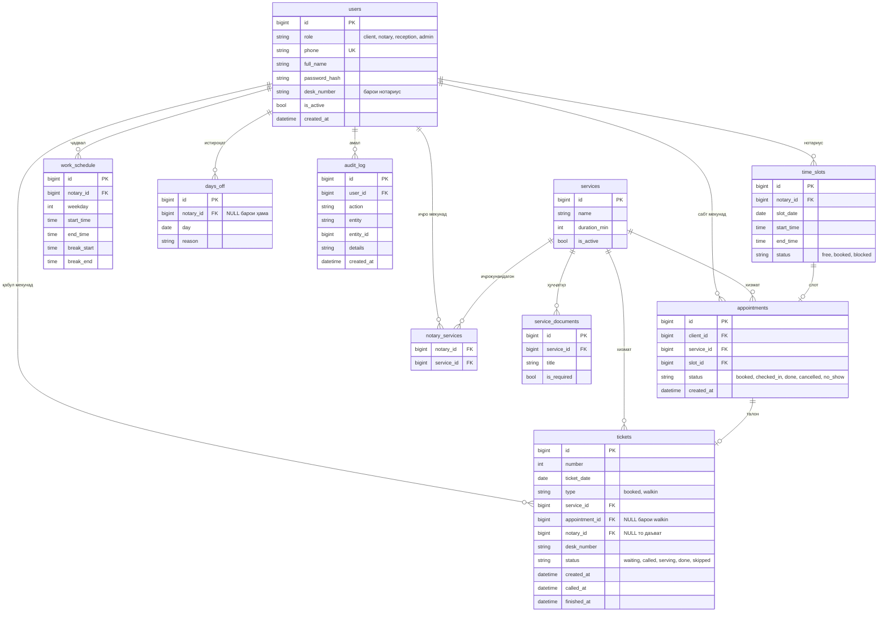
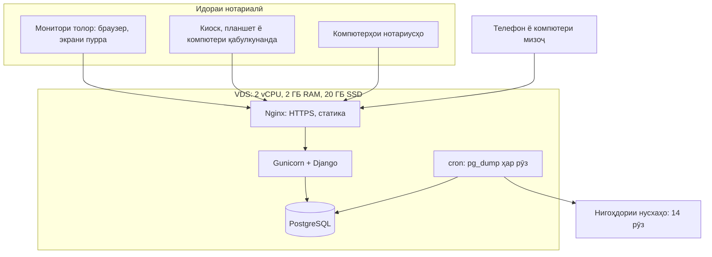

# Супориши техникӣ барои коркарди низоми иттилоотии «Навбати электронии идораи нотариалӣ»

Версияи 1.0 · [РР.ММ.СССС] · Барномасоз: [Ному насаб], гр. [...] · Фармоишгар: идораи нотариалӣ [номи идора] (шартан)

---

## 1. Маълумоти умумӣ

| Параметр | Қимат |
|---|---|
| Номи пурра | Низоми иттилоотии «Навбати электронии идораи нотариалӣ» |
| Номи кӯтоҳ | NotaryQueue (номи корӣ) |
| Фармоишгар | Идораи нотариалӣ [номи идора, суроға] |
| Иҷрокунанда | [Ному насаб], гурӯҳи [...] |
| Асоси коркард | Супориши фармоишгар; сохтори СТ мувофиқи ГОСТ 34.602 (варианти ихтисоршудаи 9 бахш) |
| Мӯҳлати коркард | Семестри [...], аз рӯзи 8 (Р-1) то рӯзи 16 (Р-2) |
| Шакли пешниҳоди натиҷа | Коди сарчашма дар GitHub, сомонаи кор дар VDS, ҳуҷҷатҳои бахши 8 |

**Мақсади ҳуҷҷат.** Ин СТ шартномаи байни фармоишгар ва барномасоз аст. Дар охири лоиҳа низом маҳз аз рӯи ин ҳуҷҷат қабул карда мешавад. Он чизеро, ки дар СТ сабт нашудааст, талаб кардан мумкин нест.

**Мақсади лоиҳа дар як ҷумла.** Мизоҷ ба нотариус пешакӣ вақт мегирад, дар идора талон мегирад ва дар вақти худ қабул карда мешавад. Мизоҷони бе сабт низ хизмат мегиранд, аммо дар ҷойҳои холӣ. Аз ин сабаб навбат дар долон кам мешавад.

---

## 2. Таъинот ва мақсадҳои эҷоди низом

### 2.1. Таъинот

Низом интизориро дар идораи нотариалӣ ба тартиб меорад. Он қабули пешакӣ ба рӯз ва вақт, талони электронӣ, даъвати мизоҷон аз ҷониби нотариус ва лавҳаи зиндаи навбатро дар экрани толор дар бар мегирад.

### 2.2. Мушкилоти ҳозира

- Мизоҷон бе вақти муайян меоянд ва дар долон меистанд.
- Мизоҷ намедонад, ки навбаташ кай мерасад.
- Идора нақшаи рӯзро пешакӣ дида наметавонад ва таърихи қабулҳо ҳисоб карда намешавад.
- Мизоҷон пешакӣ намедонанд, ки кадом ҳуҷҷатҳоро бояд биёранд, барои ҳамин бисёр маротиба бе ҳуҷҷати зарурӣ меоянд.

### 2.3. Мақсадҳои ченшаванда

Қиматҳои зерин пешниҳоди иҷрокунанда мебошанд ва бо фармоишгар мувофиқа мешаванд. Чен кардани вазъи ҳозира (baseline) ҳанӯз гузаронида нашудааст, он дар марҳилаи 1 ё пеш аз қабул гирифта мешавад.

| № | Мақсад | Нишондиҳанда | Чӣ тавр чен мекунем |
|---|---|---|---|
| М-1 | Кам кардани навбат дар долон | Мизоҷи сабтшуда аз вақти слот зиёда аз 10 дақиқа интизор намешавад (дар 90 % қабулҳо) | `tickets.called_at` минус `time_slots.start_time` |
| М-2 | Афзудани қабули пешакӣ | Пас аз 3 моҳи истифода 60 % қабулҳо бо сабти пешакӣ | Ҳисоботи рӯзона: `type = booked` / ҳамаи талонҳо |
| М-3 | Гирифтани талон зуд | Талон дар муддати то 30 сония дода мешавад | Санҷиши озмоишӣ (бахши 7) |
| М-4 | Бе хатои сабти такрорӣ | 0 ҳолати ду мизоҷ дар як слот | Санҷиши ҳамзамонӣ бо 50 дархост (бахши 7) |
| М-5 | Ҳисоби кор | Таърих ва омори рӯзона бе ҳисоби дастӣ | Ҳисоботи ТФ-10 |

---

## 3. Тавсифи объекти автоматикунонӣ

### 3.1. Ташкилот

Объект идораи нотариалӣ мебошад. Дар он [N] нотариус кор мекунад, ки ҳар кадомаш миз (кабинет) дорад: [M] миз. Соатҳои кор [08:00-17:00], танаффуси нисфирӯзӣ [12:00-13:00]. Ин рақамҳо аз фармоишгар гирифта мешаванд ва дар ҷадвали `work_schedule` нигоҳ дошта мешаванд, барои ҳамин тағйир додани онҳо коди барномаро тағйир намедиҳад.

Хизматҳои асосӣ: ваколатнома, тасдиқи нусхаи ҳуҷҷат, шартнома. Рӯйхат аз ҷониби маъмур васеъ карда мешавад.

### 3.2. Акторҳо (нақшҳо)

| Нақш | Кӣ аст | Чӣ кор мекунад |
|---|---|---|
| `client` (мизоҷ) | Шахсе, ки ба нотариус меояд | Хизматро интихоб мекунад, вақт мегирад, талон мегирад |
| `notary` (нотариус) | Корманди идора | Мизоҷи навбатиро даъват мекунад, қабулро анҷом медиҳад |
| `reception` (қабулкунанда) | Корманди назди дар ё киоск | Ба мизоҷи бе сабт талони «зинда» медиҳад, ба мизоҷ дар сабт кӯмак мекунад |
| `admin` (маъмур) | Масъули системаи идора | Хизматҳо, рӯзҳо ва соатҳои корро идора мекунад, ҳисоботро мебинад |

### 3.3. Раванд: пеш ва баъд

**Ҳозира (as-is).** Мизоҷ бе хабар меояд, дар долон меистад, нотариус аз дар мизоҷро даъват мекунад. Омор нест.

**Бо низом (to-be).**
1. Мизоҷ дар сомона хизматро ва рӯзу соатро интихоб мекунад, рӯйхати ҳуҷҷатҳоро мебинад.
2. Мизоҷ ба идора меояд ва талони электронӣ мегирад (киоск ё қабулкунанда).
3. Нотариус тугмаи «Навбатӣ»-ро мезанад. Низом мизоҷи дурустро интихоб мекунад (қоидаи бахши 4.2.1).
4. Экрани толор рақами талон ва мизро нишон медиҳад.
5. Нотариус қабулро анҷом медиҳад, таърих сабт мешавад.

### 3.4. Луғати истилоҳот

| Истилоҳ | Маъно |
|---|---|
| Слот | Фосилаи вақти ба нотариус тааллуқдошта, ки мизоҷ метавонад онро гирад (`time_slots`) |
| Сабти пешакӣ | Рекорди `appointments`: мизоҷ + хизмат + слот |
| Талон | Рақами навбат дар рӯзи ҷорӣ (`tickets`), аз 1 шурӯъ мешавад |
| Талони «зинда» (walk-in) | Талон барои мизоҷи бе сабти пешакӣ |
| Навбати омехта | Навбате, ки дар он мизоҷони сабтшуда дар вақти худ пеш аз «зинда»-ҳо хизмат мегиранд |
| Check-in | Лаҳзае, ки мизоҷи сабтшуда омада талон мегирад |
| No-show | Мизоҷи сабтшуда, ки то охири слот наомад |
| Лавҳаи толор | Экрани калон дар толор бо рақамҳои талонҳо ва мизҳо |
| MoSCoW | Тақсими талабот: Must, Should, Could, Won't |

### 3.5. Лоиҳаҳои монанд

Таҳлили аввалия (маълумоти муфассал аз сайтҳои расмии онҳо санҷида мешавад).

| Лоиҳа | Чӣ дорад | Чаро барои мо кофӣ нест |
|---|---|---|
| bcgov/queue-management (Канада, Service BC) | Сабти пешакӣ, талони «зинда», лавҳа, панели хизматрасон | Барои идораҳои калон сохта шудааст, мураккаб, бе забони тоҷикӣ |
| Easy!Appointments | Сабти пешакӣ ба слотҳо | Лавҳаи толор ва талони «зинда» нест |
| Cal.com | Сабти вохӯрӣ ва слотҳо | Барои вохӯрии онлайн, на навбати воқеӣ дар долон |
| Qmatic, Wavetec ва монанди онҳо | Навбати пурра бо киоск ва лавҳа | Тиҷоратӣ ва пулӣ, кушода нест, ба талаботи маҳаллӣ мутобиқ карда намешавад |

**Хулоса.** Ягон лоиҳаи дидашуда ҳамзамон забони тоҷикӣ, навбати омехта, сабти пешакӣ ва лавҳаи оддиро бо хароҷоти кам намедиҳад. Бинобар ин ҳалли худӣ дар Django + PostgreSQL сохта мешавад. Аз аналогҳо ғояҳо гирифта мешаванд, на код.

### 3.6. Ҳудуди лоиҳа (MVP)

**Дохил мешавад:** сабти пешакӣ, талон, даъват, лавҳаи толор, таърих ва омори рӯзона, идораи хизматҳо ва ҷадвал, нақшҳо ва иҷозатҳо.

**Дохил намешавад** (ниг. 4.2.4): пардохти онлайн, барномаи мобилии ҷудогона, нигоҳ доштани худи ҳуҷҷатҳои нотариалӣ, имзои электронӣ, ҳамгироӣ бо реестрҳои давлатӣ.

---

## 4. Талабот ба низом

### 4.1. Талабот ба низом дар маҷмӯъ

#### 4.1.1. Талаботи ғайрифунксионалӣ (ТҒФ)

| № | Талабот | Меъёр | Чӣ тавр санҷидан |
|---|---|---|---|
| ТҒФ-01 | Навсозии лавҳаи толор | Лавҳа бе навсозии саҳифа, дар муддати то 3 сония тағйиротро нишон медиҳад | Санҷиши T-07 |
| ТҒФ-02 | Суръат | 95 % дархостҳо дар то 2 сония, ҳангоми 20 корбари ҳамзамон | Асбоби бор (масалан, Locust) |
| ТҒФ-03 | Дурустии сабт | Ду мизоҷ як слотро гирифта наметавонанд (қулфи сатр дар PostgreSQL) | Санҷиши T-04 |
| ТҒФ-04 | Боэътимодӣ | Нусхаи эҳтиётии ПД ҳар рӯз, нигоҳдорӣ 14 рӯз | Санҷиши барқарорсозӣ (T-12) |
| ТҒФ-05 | Дастрасӣ | Кор дар соатҳои кории идора, мақсад 99 % | Мониторинг, бахши 7 |
| ТҒФ-06 | Амният | HTTPS, пароли нотариус ва маъмур ҳэш карда мешавад (Django), иҷозатҳо аз рӯи нақш | T-09, T-10 |
| ТҒФ-07 | Махфият | Дар лавҳаи толор танҳо рақами талон ва миз нишон дода мешавад, на ном | T-08 |
| ТҒФ-08 | Забон | Интерфейс бо забони тоҷикӣ ва русӣ, ҳамаи маълумот дар UTF-8 | T-13 |
| ТҒФ-09 | Вақт | Таймзонаи `Asia/Dushanbe` | T-13 |
| ТҒФ-10 | Мутобиқат | Браузерҳои нави Chrome, Firefox, Edge; намоиш дар телефон ва экрани калон | Санҷиши дастӣ |

#### 4.1.2. Ҳайати кормандон

Низомро 1 маъмур, [N] нотариус ва 1-2 қабулкунанда истифода мебаранд. Мизоҷон ба ҳисоби алоҳида ҳисоб карда намешаванд. Омӯзиши кормандон: 1 соат аз рӯи дастури корбар.

#### 4.1.3. Қоидаҳои ҳифзи маълумоти шахсӣ

Низом танҳо рақами телефон ва номи мизоҷро нигоҳ медорад. Маълумот ба шахси сеюм дода намешавад. Талаботи қонунгузории Ҷумҳурии Тоҷикистон оид ба ҳифзи маълумоти шахсӣ бояд бо фармоишгар санҷида шавад (масъала барои мувофиқа).

### 4.2. Талабот ба функсияҳо

#### 4.2.1. Рӯйхати талаботи функсионалӣ (ТФ) бо MoSCoW

| № | Функсия | MoSCoW | Тавсиф | Чӣ тавр санҷидан |
|---|---|---|---|---|
| ТФ-01 | Рӯйхати хизматҳо | Must | Хизматҳо бо давомнокӣ ва рӯйхати ҳуҷҷатҳои лозим (ҳатмӣ ё не) нишон дода мешаванд | Мизоҷ хизматро мекушояд ва ҳуҷҷатҳоро мебинад |
| ТФ-02 | Сабти пешакӣ | Must | Мизоҷ хизмат, рӯз ва слоти холиро интихоб мекунад | Баъди сабт слот `booked` мешавад |
| ТФ-03 | Ҳифз аз сабти такрорӣ | Must | Як слотро ду нафар гирифта наметавонанд | T-04: 50 дархости ҳамзамон, 1 муваффақ |
| ТФ-04 | Талон ҳангоми омадан | Must | Мизоҷи сабтшуда (check-in) ва мизоҷи бе сабт талон мегиранд | Рақами талон дода мешавад, `UNIQUE(date, number)` |
| ТФ-05 | Даъвати навбатӣ | Must | Нотариус тугмаи «Навбатӣ»-ро мезанад, низом мизоҷи дурустро аз рӯи қоидаи омехта интихоб мекунад | T-05, T-06 |
| ТФ-06 | Лавҳаи толор | Must | Экран бе навсозии саҳифа рақами талон ва мизро нишон медиҳад | T-07 |
| ТФ-07 | Анҷоми қабул | Must | Нотариус қабулро анҷом медиҳад ё мизоҷро мегузаронад (skipped) | Статусҳо дар ПД тағйир меёбанд |
| ТФ-08 | Идораи хизматҳо | Must | Маъмур хизмат ва ҳуҷҷатҳоро илова ва таҳрир мекунад | Хизмати нав дар сомона пайдо мешавад |
| ТФ-09 | Ҷадвали кор ва рӯзҳои истироҳат | Must | Маъмур соатҳо, танаффус ва рӯзҳои ғайрикориро танзим мекунад, слотҳо аз рӯи он сохта мешаванд | Дар рӯзи истироҳат слот нест |
| ТФ-10 | Таърих ва омори рӯзона | Must | Рӯйхати қабулҳо ва ҳисобот барои рӯз | Ҳисобот бо ПД мувофиқ аст |
| ТФ-11 | Вуруд ва нақшҳо | Must | Вуруд бо телефон ва парол, ҳуқуқҳо аз рӯи нақш | T-09, T-10 |
| ТФ-12 | Бекор кардан ва гузарондан | Should | Мизоҷ сабтро то 2 соат пеш аз қабул бекор ё ба вақти дигар мегузаронад | Слот дубора озод мешавад |
| ТФ-13 | Қоидаи дерӣ ва no-show | Should | Дер омада (зиёда аз 10 дақ.) ба навбати умумӣ меафтад; то охири слот наомада `no_show` мешавад | T-05, T-06 |
| ТФ-14 | Тасдиқи телефон бо SMS (OTP) ва ёдраскунӣ | Should | Тасдиқи рақам ва SMS «пагоҳ соати 10:30 қабул доред» | SMS-и озмоишӣ дар провайдери интихобшуда |
| ТФ-15 | Журнали аудит | Should | Ҳар тағйирот сабт мешавад (кӣ, кай, чӣ) | `audit_log` пур мешавад |
| ТФ-16 | Забони тоҷикӣ ва русӣ | Should | Интерфейс ду забон дорад | T-13 |
| ТФ-17 | Садо ва овози лавҳа | Could | «Талони 012, ба миз 2» | Санҷиши дастӣ |
| ТФ-18 | QR-код дар талон | Could | Мизоҷ талонро бо QR мекушояд | Санҷиши дастӣ |
| ТФ-19 | Содироти Excel/CSV | Could | Ҳисобот ба файл | Файл кушода мешавад |
| ТФ-20 | Telegram-бот барои ёдраскунӣ | Could | Ба ҷои SMS | Санҷиши дастӣ |

**Қоидаи навбати омехта (ТФ-05, ТФ-13).** Вақте нотариус «Навбатӣ»-ро мезанад, низом аз талонҳои `waiting`-и хизматҳое, ки ин нотариус иҷро мекунад, ин тартибро мегирад:

1. Талонҳои сабтшуда (`type = booked`), ки вақти слот расидааст (аз `start_time - 10 дақ.` то `start_time + 10 дақ.`). Тартиб аз рӯи `start_time`.
2. Агар чунин талон набошад, талонҳои «зинда» ва талонҳои сабтшудаи дер омада (зиёда аз 10 дақиқа), аз рӯи вақти гирифтани талон (FIFO).
3. Агар мизоҷи сабтшуда ҳанӯз наомадааст, нотариус бекор намеистад ва мизоҷи «зинда»-ро даъват мекунад.
4. Агар мизоҷи даъватшуда дар 5 дақиқа наояд, талон `skipped` мешавад ва нотариус навбатии дигарро даъват мекунад.

Мизоҷи сабтшуда, ки то `end_time`-и слот наомад, `no_show` мешавад ва слот озод мешавад. Рақами нав мегирад, агар дубора биёяд, ҳамчун мизоҷи «зинда».

#### 4.2.2. User stories (афзалият Must)

| № | User story | Меъёри қабул (санҷиданашаванда дар бахши 7) | ТФ |
|---|---|---|---|
| US-01 | Ҳамчун мизоҷ, мехоҳам аз хона рӯз ва соати қабулро интихоб кунам, то дар долон интизор нашавам | Рӯйхати слотҳои холӣ нишон дода мешавад; баъди тасдиқ слот банд мешавад ва мизоҷ сабти худро мебинад; слоти банд барои дигарон дастнорас аст | ТФ-01, 02, 03 |
| US-02 | Ҳамчун мизоҷ, мехоҳам пеш аз омадан бидонам, ки кадом ҳуҷҷатҳоро биёрам | Барои хизмати интихобшуда рӯйхати ҳуҷҷатҳо бо нишони «ҳатмӣ» нишон дода мешавад | ТФ-01 |
| US-03 | Ҳамчун мизоҷ, ҳангоми омадан талон мегирам | Талон рақами беҳамто дорад (дар як рӯз такрор намешавад); барои мизоҷи сабтшуда бо сабти худ пайваст аст | ТФ-04 |
| US-04 | Ҳамчун қабулкунанда, ба мизоҷи бе сабт талони «зинда» медиҳам | Талон `type = walkin` ва `appointment_id = NULL` мегирад | ТФ-04 |
| US-05 | Ҳамчун нотариус, бо як тугма мизоҷи навбатиро даъват мекунам | Ҳамеша мизоҷи дурусти қоидаи бахши 4.2.1 интихоб мешавад: сабтшуда дар вақти худ пеш аз «зинда» | ТФ-05, 13 |
| US-06 | Ҳамчун мизоҷ, рақами худро дар экрани толор мебинам | Лавҳа дар 3 сония нав мешавад, саҳифа аз нав боргирӣ намешавад, ном нишон дода намешавад | ТФ-06 |
| US-07 | Ҳамчун маъмур, хизматҳо ва соатҳои корро идора мекунам | Хизмати нав ё рӯзи истироҳат фавран ба слотҳо таъсир мерасонад | ТФ-08, 09 |
| US-08 | Ҳамчун маъмур, омори рӯзонаро мебинам | Ҳисобот шумораи сабтшуда, омада, қабулшуда ва no-show-ро нишон медиҳад | ТФ-10 |

#### 4.2.3. Матрисаи дастрасӣ «нақш × функсия»

| Функсия | admin | notary | reception | client |
|---|---|---|---|---|
| Рӯйхати хизматҳо ва ҳуҷҷатҳо (ТФ-01) | ҳа | ҳа | ҳа | ҳа |
| Сабти пешакӣ (ТФ-02) | — | — | ҳа (аз номи мизоҷ) | ҳа |
| Гирифтани талон (ТФ-04) | — | — | ҳа (ҳам «зинда») | ҳа (check-in) |
| Даъвати навбатӣ (ТФ-05) | — | ҳа | — | — |
| Лавҳаи толор (ТФ-06) | дидан | дидан | дидан | дидан |
| Анҷоми қабул (ТФ-07) | — | ҳа (қабулҳои худ) | — | — |
| Идораи хизматҳо (ТФ-08) | ҳа | — | — | — |
| Ҷадвали кор ва рӯзҳои истироҳат (ТФ-09) | ҳа | — | — | — |
| Таърих ва омор (ТФ-10) | ҳамаро | қабулҳои худ | қабулҳои рӯз | сабтҳои худ |
| Бекор кардан ва гузарондан (ТФ-12) | — | — | ҳа | ҳа (сабти худ) |
| Журнали аудит (ТФ-15) | ҳа | — | — | — |

Нақшҳо дар таҳлил (3.2), use case (5.1), матрисаи дастрасӣ ва ENUM-и `users.role` (5.4) якхелаанд: `client`, `notary`, `reception`, `admin`.

#### 4.2.4. Берун аз ҳудуди лоиҳа (Won't)

Ин рӯйхат ба фармоишгар нишон медиҳад, ки чӣ дар версияи 1.0 нест, то баъдтар талаби иловагӣ бе мувофиқа пайдо нашавад.

- Пардохти онлайн барои хизматҳо.
- Барномаи мобилии ҷудогона (сомона дар телефон кор мекунад).
- Нигоҳ доштани худи ҳуҷҷатҳои нотариалӣ ва реестрҳо.
- Имзои электронӣ.
- Ҳамгироӣ бо реестрҳои давлатӣ.

#### 4.2.5. Параметрҳои танзимшаванда

Ҳамаи қиматҳо пешниҳоди иҷрокунанда мебошанд ва бо фармоишгар мувофиқа мешаванд. Онҳо дар танзимоти низом ҳастанд, на дар код.

| Параметр | Пешфарз |
|---|---|
| Вақти афзалият пеш аз слот | 10 дақиқа |
| Вақти афзалият баъди слот (дерӣ) | 10 дақиқа |
| Интизории мизоҷи даъватшуда | 5 дақиқа |
| Давраи сабти пешакӣ | 14 рӯз пеш |
| Бекор кардан то қабул | 2 соат |
| Ҳадди сабти фаъол барои як телефон | 3 |
| Навсозии лавҳа | 3 сония |

### 4.3. Талабот ба намудҳои таъминот

- **Иттилоотӣ:** ПД `notary_queue` дар PostgreSQL, 10 ҷадвал, шакли нормалии сеюм (3ШН), рамзгузории UTF-8 (ниг. бахши 5.4).
- **Барномавӣ:** Python 3.12+, Django 5, Django REST Framework (API-и лавҳа), PostgreSQL 16, HTMX барои саҳифаҳо, Gunicorn + Nginx. Санҷиш бо pytest.
- **Техникӣ:** VDS 2 vCPU, 2 ГБ RAM, 20 ГБ SSD (ниг. диаграммаи ҷойгиркунӣ). Дар идора: монитори калон (телевизор) бо браузер барои лавҳа; планшет ё компютер барои киоск; термопринтери талон (ихтиёрӣ).
- **Лингвистӣ:** интерфейс ба тоҷикӣ ва русӣ (Django i18n); ворид ва нигоҳдории маълумот бо ҳарфҳои кириллӣ бе таҳриф (UTF-8).

---

## 5. Моделҳои система

Диаграммаҳо бо забони Mermaid навишта шудаанд, GitHub онҳоро дар худи саҳифа намоиш медиҳад. Барои экспорти PNG: https://mermaid.live.

### 5.1. Вариантҳои истифода

*Расми 1. Чор нақш ва 13 варианти истифода. Ба ҳар талаби Must як вариант мувофиқ аст (ҷадвали 5.5).*

### 5.2. Раванди «Қабул аз рӯи навбат»

*Расми 2. Ҳолатҳои `appointments.status` (booked, checked_in, done, cancelled, no_show) ва `tickets.status` (waiting, called, serving, done, skipped) бо ENUM-и ПД мувофиқанд. Ҳолати `cancelled` дар ТФ-12 истифода мешавад (бекор кардани мизоҷ то оғози ин раванд).*

### 5.3. Пайдарпайии амалҳо

*Расми 3. Аз сабт то анҷоми қабул. `SELECT ... FOR UPDATE` дар як транзаксия ҳифз аз сабти такрориро таъмин мекунад (ТФ-03).*

### 5.4. Сохтор: диаграммаи синфҳо

*Расми 4. Ҳамаи 10 моҳият дар диаграммаи ER (расми 6) низ ҳастанд. Номи синфҳо бо номи ҷадвалҳо мувофиқ аст.*

### 5.5. Сохтор: диаграммаи компонентҳо

*Расми 5. Низом як барномаи Django бо чанд модул аст. Лавҳа танҳо `api`-ро мехонад ва ҳуқуқи навиштан надорад.*

### 5.6. Додаҳо: диаграммаи ER

*Расми 6. 10 ҷадвал (панҷтои ҳатмӣ: `users`, `services`, `time_slots`, `appointments`, `tickets`). Маҳдудиятҳо: `UNIQUE (slot_id)` дар `appointments` барои сабтҳои фаъол (partial unique index барои `booked` ва `checked_in`), `UNIQUE (ticket_date, number)` дар `tickets`, `UNIQUE (phone)` дар `users`. Ҳангоми сабт `transaction.atomic()` ва `select_for_update()`.*

### 5.7. Ҷойгиркунӣ

*Расми 7. Ҳамаи дастгоҳҳо тавассути интернет бо як сервер кор мекунанд. Лавҳа дар браузери оддӣ кор мекунад (kiosk-режим), дастгоҳи махсус лозим нест.*

### 5.8. Пайгирӣ: user story → ТФ → use case → ҷадвалҳои ПД

| User story | ТФ | Use case | Диаграммаҳо | Ҷадвалҳои ПД |
|---|---|---|---|---|
| US-01 | ТФ-01, 02, 03 | UC-01, UC-02 | Расм 2, 3 | `services`, `time_slots`, `appointments` |
| US-02 | ТФ-01 | UC-01 | Расм 1 | `services`, `service_documents` |
| US-03 | ТФ-04 | UC-04 | Расм 2, 3 | `appointments`, `tickets` |
| US-04 | ТФ-04 | UC-08 | Расм 2 | `tickets` |
| US-05 | ТФ-05, 07, 13 | UC-06, UC-07 | Расм 2, 3 | `tickets`, `appointments`, `notary_services` |
| US-06 | ТФ-06 | UC-05 | Расм 3, 5 | `tickets` (мехонад) |
| US-07 | ТФ-08, 09 | UC-09, UC-10 | Расм 1, 5 | `services`, `service_documents`, `work_schedule`, `days_off`, `time_slots` |
| US-08 | ТФ-10 | UC-11 | Расм 1, 5 | `tickets`, `appointments` (мехонад) |

---

## 6. Таркиб ва мундариҷаи корҳо

Санаҳоро аз рӯи ҷадвали дарсҳои гурӯҳ гузоред.

| Марҳила | Корҳо | Натиҷа | Мӯҳлат |
|---|---|---|---|
| 1. Лоиҳакашӣ | таҳлил, СТ, моделҳо, ПД | ҳамин ҳуҷҷат, `schema.sql`, `seed.sql`, `queries.sql` | рӯзи 8 (Р-1), [РР.ММ.СССС] |
| 2. Дизайн | UX/UI дар Figma (лавҳа, сабт, панели нотариус) | макет ва прототип | рӯзи 9, [РР.ММ.СССС] |
| 3. Frontend | тарҳбандӣ, HTMX, лавҳа | саҳифаҳои статикӣ ва лавҳа | рӯзҳои 10-11, [РР.ММ.СССС] |
| 4. Backend | Django, ПД, нақшҳо, навбати омехта, API-и лавҳа | MVP-и коркунанда | рӯзҳои 12-14, [РР.ММ.СССС] |
| 5. Санҷиш | тест-кейсҳо, pytest (аввал қоидаи навбат) | `15-test-cases.md` | рӯзи 15, [РР.ММ.СССС] |
| 6. Нашр | VDS, HTTPS, нусхаи эҳтиётӣ | сомона дар интернет | рӯзи 16 (Р-2), [РР.ММ.СССС] |

---

## 7. Тартиби назорат ва қабул

### 7.1. Меъёри қабул

Низом қабулшуда ҳисобида мешавад, агар:

1. 100 % user stories-и Must (US-01...US-08) бо меъёрҳои қабули худ гузаранд;
2. ҳамаи ТФ-и Must бо усули сутуни «Чӣ тавр санҷидан» тасдиқ шаванд;
3. ТҒФ-01, 03, 06, 07 иҷро шаванд;
4. хатоҳои дорои афзалияти «критикӣ» набошанд (критикӣ: ду мизоҷ дар як слот, мизоҷ ном дар лавҳа, иҷозати нодуруст, гум шудани маълумот).

### 7.2. Логинҳои санҷишӣ

`admin`, `notary1`, `notary2`, `reception`, `client1` (паролҳо дар `seed.sql`, танҳо барои санҷиш, дар сервери кор иваз карда мешаванд).

### 7.3. Тартиби озмоишҳо

| № | Санҷиш | Қадамҳо | Натиҷаи интизорӣ |
|---|---|---|---|
| T-01 | Рӯйхати хизматҳо (US-02) | `client1` саҳифаи хизматҳоро мекушояд | Ҳуҷҷатҳо бо нишони «ҳатмӣ» дида мешаванд |
| T-02 | Сабти пешакӣ (US-01) | `client1` слоти холиро мегирад | Слот `booked`, сабти `booked` пайдо мешавад |
| T-03 | Рӯзи истироҳат (US-07) | `admin` рӯзро ғайрикорӣ мекунад | Дар он рӯз слоти холӣ намеояд |
| T-04 | Сабти такрорӣ (US-01, ТҒФ-03) | 50 дархости ҳамзамон ба як слот | Танҳо 1 муваффақ, 49 хатои «слот банд аст» |
| T-05 | Навбати омехта: бо сабт ва зинда (US-05) | Як мизоҷи сабтшуда (слот 10:00), як «зинда» ба 09:55 меояд, нотариус соати 10:00 «Навбатӣ» мезанад | Аввал мизоҷи сабтшуда даъват мешавад |
| T-06 | Дер омадан ва no-show (US-05) | Мизоҷ 15 дақиқа дер меояд; дигар то охири слот намеояд | Якум ба навбати умумӣ меафтад, дуюм `no_show`, слот озод |
| T-07 | Лавҳа бе навсозии саҳифа (US-06, ТҒФ-01) | Нотариус мизоҷро даъват мекунад, лавҳа кушода аст | Рақам дар то 3 сония пайдо мешавад, саҳифа аз нав бор намешавад |
| T-08 | Махфият (ТҒФ-07) | Кодро ва API-и `/api/board/`-ро санҷед | Ном ва телефон нест, танҳо рақам ва миз |
| T-09 | Нақшҳо (US-07) | `client1` ба `/admin/`, `notary1` ба танзимоти хизматҳо | Дастрасӣ рад мешавад |
| T-10 | Матрисаи дастрасӣ | Аз рӯи ҷадвали 4.2.3 ҳар нақш ҳар функсияро месанҷад | Натиҷа бо ҷадвал мувофиқ аст |
| T-11 | Талони «зинда» (US-04) | `reception` талон медиҳад | `type = walkin`, `appointment_id = NULL`, рақам беҳамто |
| T-12 | Нусхаи эҳтиётӣ (ТҒФ-04) | Нусхаро ба ПД-и озмоишӣ барқарор кунед | Маълумот пурра барқарор мешавад |
| T-13 | Забон ва вақт (ТҒФ-08, 09) | Забонро иваз кунед, ҳарфҳои ӣ, ӯ, қ, ғ, ҳ, ҷ ворид кунед | Дуруст нигоҳ дошта ва нишон дода мешаванд, вақт Asia/Dushanbe |
| T-14 | Омор (US-08) | `admin` ҳисоботи рӯзро мекушояд | Рақамҳо бо ПД мувофиқанд |

Санҷиши қоидаи навбат бо тестҳои pytest (`services/queue.py`) илова карда мешавад: дер омадан, барвақт омадан, no-show, якчанд нотариус.

---

## 8. Талабот ба ҳуҷҷатгузорӣ

| Ҳуҷҷат | Мундариҷа |
|---|---|
| `README.md` | Тавсифи лоиҳа, насб ва оғози кор |
| `docs/08-technical-specification.md` | Ҳамин СТ |
| `database/schema.sql`, `seed.sql`, `queries.sql` | Сохтори ПД, маълумоти озмоишӣ, дархостҳои намунавӣ |
| `docs/15-test-cases.md` | Тест-кейсҳо ва натиҷаҳо |
| `docs/16-deploy.md` | Дастури ҷойгиркунӣ дар VDS ва нусхаи эҳтиётӣ |
| Дастури корбар | Барои мизоҷ, нотариус, қабулкунанда ва маъмур (бо скриншот) |

---

## 9. Манбаъҳои коркард

- ГОСТ 34.602-89. Техническое задание на создание автоматизированной системы.
- Ҳуҷҷатгузории расмии Django 5: https://docs.djangoproject.com
- Ҳуҷҷатгузории Django REST Framework: https://www.django-rest-framework.org
- Ҳуҷҷатгузории PostgreSQL: https://www.postgresql.org/docs
- HTMX: https://htmx.org
- Mermaid (диаграммаҳо): https://mermaid.js.org
- Лоиҳаҳои монанд: bcgov/queue-management, Easy!Appointments, Cal.com (GitHub ва сайтҳои расмӣ)
- Қонунгузории Ҷумҳурии Тоҷикистон оид ба ҳифзи маълумоти шахсӣ (матни дақиқ бо фармоишгар санҷида мешавад)
- Корҳои лабораторӣ 1-7: таҳлили соҳа, ҷадвали муқоиса, СТ-и кӯтоҳ, диаграммаҳо, ПД
